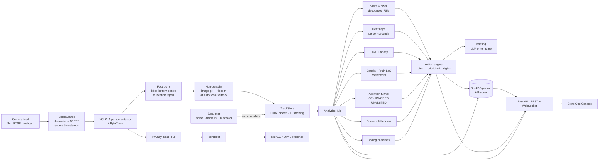
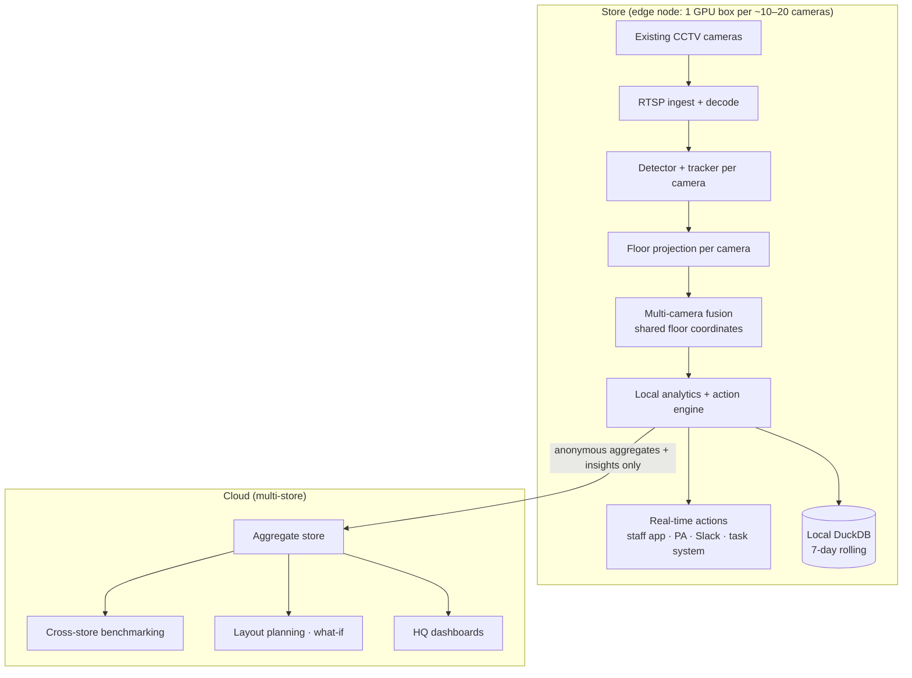

# FlowSight architecture

## 1. Per-frame pipeline (one camera)

**Design rule:** everything after the TrackStore works on floor-metre trajectories with timestamps and never
sees pixels. As a result:
* metrics are physical: m/s, people/m², Fruin Level of Service, metres walked;
* the analytics can be validated exactly. The simulator feeds the same hub with known ground truth (see `runs/eval/report.md`);
* analytics cost does not depend on camera resolution or model size.

## 2. Edge-to-cloud deployment

* **Edge** does all video work: no frames leave the store. Real-time actions (open a lane, clear a walkway,
  assist a shopper) fire locally with sub-second latency and keep working when the WAN is down.
* **Cloud** only receives anonymous aggregates: zone-window KPIs, bottleneck episodes, attention funnels and
  insights. These are small (a few KB per zone per 5 minutes), so 10,000 stores remain cheap to ingest.
* **Multi-camera fusion (implemented, `flowsight/tracking/fusion.py`):** every camera projects into the same
  floor frame; per frame, observations are Hungarian-matched across cameras within a 1 m gate, each cluster
  carries a persistent *fused key* (that is the hand-off: camera B's tracker ID is bound to the key camera A's
  track already holds), and fused observations feed one global TrackStore whose ID stitching also bridges short
  gaps between non-overlapping views. No appearance features (privacy).
* **Camera onboarding without a survey (`flowsight/geometry/autocalib.py`):** a new camera is calibrated from a few
  minutes of normal traffic seen by an already-calibrated neighbour: clock offset + homography by guarded
  LO-RANSAC over cross-camera pairings of *walking* people. Validated against CAVIAR ground truth
  (docs/multicam_autocalib.md).
* **Scalability:** the detector is the only GPU-bound stage. The analytics handle >100 people per frame at
  hundreds of FPS on one CPU core (`docs/benchmarks.md`), so one edge box covers a typical store. Models export
  to ONNX/OpenVINO/TensorRT for cheaper hardware.
* **Integration hooks:** `Insight` objects have a stable JSON schema (owner, horizon, action, evidence,
  expected impact, confidence) and are designed to be pushed to webhooks, Slack/Teams, store PA systems or
  task-management tools. The action engine's dedup, cooldown and auto-resolve logic keeps those channels from
  being spammed.

## 3. Privacy by design

| Principle | Implementation |
|---|---|
| No biometric data | No face detection, no face recognition, no appearance embeddings, no re-identification by looks. |
| No identity | Track IDs are per-session integers assigned by FlowSight; raw tracker IDs are never exposed; IDs are not linked across days or stores. |
| Data minimisation | Analytics store only anonymous floor-metre trajectories (downsampled to 2 Hz) and aggregates. |
| No raw video retention | Frames are processed in memory. With `privacy.store_frames: evidence_only`, at most one privacy-blurred snapshot per insight is saved; `none` saves no frames at all. |
| Irreversible blurring | The head region (top 22 % of each person box) is pixelated and then Gaussian-blurred on every frame that leaves the pipeline (MJPEG stream, MP4, evidence snapshots, calibration frames). |
| Edge processing | Video never leaves the store; the cloud receives aggregates only. |

This fits the data-minimisation and purpose-limitation principles of GDPR and India's DPDP Act. Store-level
signage and a DPIA remain the operator's responsibility.

## 4. Key algorithms

* **Visit FSM:** OUTSIDE → ENTERING (≥ `enter_min_s`) → INSIDE → EXITING (≥ `exit_grace_s` outside) → OUTSIDE.
  Boundary jitter does not create extra visits; entry = first inside sample, exit = last inside sample.
* **Engaged dwell / stop:** time inside at < 0.3 m/s; a stop requires ≥ 3 s engaged.
* **Exposure:** the track entered the zone polygon dilated by 1.5 m. Stopping power = stops / exposures.
* **Bottleneck:** for walkway, entrance and aisle zones, LoS ≥ D, or speed < 50 % of the zone's learned free-flow
  speed with ≥ 3 people, sustained for ≥ 20 s. Time lost = Σ dt · max(0, 1 − v/v_free).
* **Queue:** L = slow people in the checkout zone; λ = entries/s over 5 min; W = L/λ (Little's law), cross-checked
  against the observed dwell of completed checkout visits.
* **ID stitching:** a new raw ID appearing ≤ 2 s after a track was lost, within 1.2 m of the lost track's
  constant-velocity prediction and not behind its heading, inherits that track's ID.
