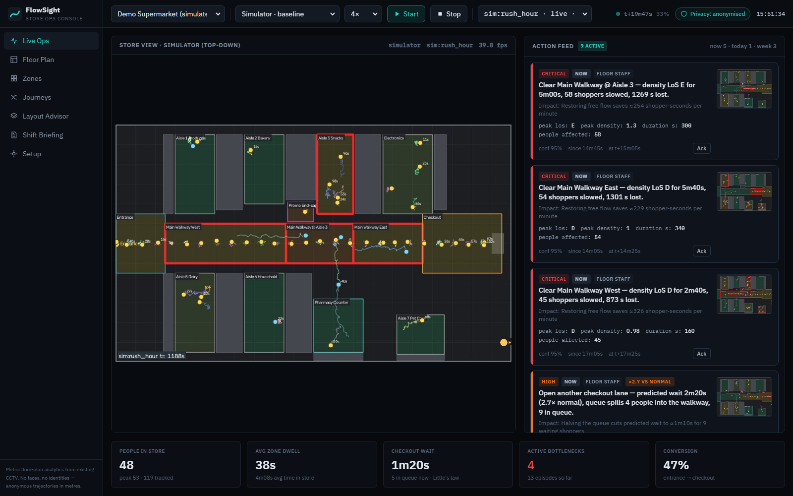
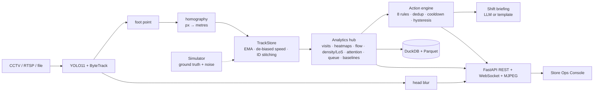

# FlowSight: retail dwell-time & bottleneck intelligence

**FlowSight turns ordinary in-store CCTV into actions a store can take right now.** It detects and tracks
shoppers, blurs every head, and projects each person's feet onto the store's floor plan **in metres**. From those
anonymous trajectories it measures section dwell, attention funnels, crowd density (Fruin Level of Service),
checkout queues (Little's law) and customer journeys. A rule engine turns the metrics into a prioritised **action feed**:
*"Open another checkout lane — predicted wait 3m01s (3.8× normal), queue spills 5 people into the walkway"*,
*"Promo End-cap: 212 shoppers passed, only 3% stopped — refresh signage"*,
*"What-if: moving the promo next to Aisle 3 ≈ +58 engaged visits/day (estimate)"*.
Every analytic is **validated against a simulator with ground truth**.



## Why it is different

| | Typical "YOLO + heatmap" demo | FlowSight |
|---|---|---|
| Units | pixels | **metres on the floor plan** (homography): m/s, people/m², Fruin LoS A–F |
| Correctness | eyeballed | **measured vs ground truth**: dwell MAE 0.24 s, visit F1 0.95, zone classification 100% |
| Output | charts | **prioritised actions** with owner, horizon, evidence, ×-vs-normal and expected impact |
| Insight | "busy here" | separates **IGNORED** (people pass, don't stop: merchandising problem) from **UNVISITED** (nobody passes: layout problem); stopping-power funnel; what-if relocation |
| Deployment | GPU notebook | existing cameras, **privacy by design** (no faces/identity), 73 FPS detector / 46 FPS full pipeline on a laptop GPU, analytics < 1 ms per frame, edge-to-cloud design |

## Quick start

```bash
make setup      # venv + CUDA/CPU torch + deps + YOLO11 weights + npm install
make data       # CAVIAR shopping-centre corridor clips + MOT sequences, floor plans
make demo       # API + built console on http://127.0.0.1:8000, auto-starts rush_hour sim + real clip
```

On Windows without `make`: `python scripts/tasks.py setup|data|demo|test|eval|bench`.

Other entry points:

```bash
python -m flowsight.cli process --store caviar_corridor --camera cam1   # annotated MP4 + DuckDB + heatmaps
python -m flowsight.cli sim --scenario rush_hour --duration 1500        # simulator through the full stack
python -m flowsight.cli eval --seeds 5 --duration 1800                  # accuracy report -> runs/eval/report.md
python -m flowsight.cli calibrate --store <id> --camera <cam>           # click points -> homography
python scripts/bench.py                                                 # -> docs/benchmarks.md
make test                                                               # 35 tests
```

Set `ANTHROPIC_API_KEY` to have the shift briefing written by Claude (model in `config/default.yaml`).
Without it, a deterministic template writes the briefing, so everything works offline.

## Architecture



Details, the edge-to-cloud design, multi-camera fusion and the privacy stance are in [ARCHITECTURE.md](ARCHITECTURE.md).
Every judgement call made during the build is logged in [DECISIONS.md](DECISIONS.md).

## Metric definitions

| Metric | Definition |
|---|---|
| Visit | Debounced zone presence: entered ≥ 1.0 s; ends after ≥ 1.5 s outside (boundary jitter ≠ new visits) |
| Dwell | last inside timestamp − first inside timestamp of a visit |
| Engaged dwell | time inside moving < 0.3 m/s (noise-de-biased speed) |
| Stop | visit with ≥ 3 s engaged |
| Exposure | unique shopper who entered the zone or its 1.5 m exposure buffer |
| Stopping power | stopping shoppers / exposed shoppers |
| UNVISITED / IGNORED / HOT | exposure < 20 % of median zone · normal exposure but stopping power < 8 % · top-decile stopping power |
| Density, LoS | mean people / zone m² per 5 s window → Fruin A (≥ 3.3 m²/p) … F (< 0.5 m²/p) |
| Free-flow speed | per zone, p75 of speeds observed at LoS A/B |
| Bottleneck | walkway/entrance/aisle with LoS ≥ D, or speed < 50 % free-flow with ≥ 3 people (aisles: and LoS ≥ C), for ≥ 20 s |
| Time lost | Σ dt · max(0, 1 − v / v_free) over people in the zone during a bottleneck |
| Queue wait | Little's law W = L / λ (L = slow people in checkout, λ = arrivals/s over 5 min); for new arrivals also (L + spill-over) / μ |
| Heatmap | person-seconds per 0.25 m cell (time-weighted, not frame counts); stationary variant < 0.3 m/s |
| Conversion | shoppers with an entrance visit who later visit checkout |

## Accuracy vs ground truth (`runs/eval/report.md`)

25 runs = 5 scenarios × 5 seeds × 30 simulated minutes. The measured pipeline sees σ = 0.15 m position noise,
2 % dropouts and random ID breaks, and runs through the real TrackStore. Ground truth applies the same definitions to perfect data.

| Scenario | Visit F1 | Dwell MAE | BN recall (sustained ≥ 60 s) | BN recall (all) | BN precision | Zone classification | Queue-wait MAE |
|---|---|---|---|---|---|---|---|
| baseline | 0.966 | 0.21 s | – | 0.44 | 0.80 | 100 % | 7.9 s |
| rush_hour | 0.928 | 0.32 s | **1.00** | 0.82 | 0.94 | 100 % | 10.8 s |
| blocked_aisle | 0.936 | 0.28 s | **1.00** | 0.75 | 0.99 | 100 % | 12.9 s |
| ignored_promo | 0.969 | 0.19 s | – | 0.72 | 0.50 | 100 % (promo → IGNORED) | 8.7 s |
| dead_aisle | 0.970 | 0.22 s | 1.00 | 0.60 | 0.60 | 100 % (aisle 7 → UNVISITED) | 8.6 s |
| **all** | **0.954** | **0.24 s** | **1.00** | 0.66 | 0.78 | **100 %** | 9.8 s |

Targets: dwell MAE < 1.5 s ✅ · visit F1 > 0.9 ✅ · ignored/unvisited correctly classified ✅ · rush-hour bottleneck
recall ≥ 0.9: ✅ for sustained jams (1.00, ~4 s latency), ❌ 0.82 when 20–40 s threshold-straddling aisle crowds are
included (see DECISIONS.md). Track fragmentation is 1.07 stable IDs per true shopper, with ~290 ID breaks per run repaired by stitching.

## Benchmarks (RTX 4060 Laptop GPU): see [docs/benchmarks.md](docs/benchmarks.md)

| Stage | Throughput |
|---|---|
| YOLO11s @960 FP16 + ByteTrack (CAVIAR 384×288) | **73 FPS** (13.6 ms/frame) |
| YOLO11s @960 FP16 + ByteTrack (MOT20 1080p dense crowd, ~16 people) | **67 FPS** |
| Full video pipeline incl. foot points, homography, analytics, head blur, rendering, MP4 writing | **46 FPS** |
| Analytics only (track store + all analytics + action engine), 20 / 200 people per frame | **0.7 ms / 2.5 ms** per frame |

At 10 FPS analytics per camera, one RTX 4060 laptop handles ~7 cameras with sequential single-stream inference
(per-call latency dominates; batched multi-camera inference raises this), and one CPU core runs the analytics
for >100 cameras.

## Privacy

* No face detection or recognition, no appearance embeddings, no identity. IDs are per-session integers.
* The head region of every person box is pixelated and blurred on every frame that leaves the pipeline (stream, MP4, evidence, calibration frame).
* Only anonymous floor-metre trajectories (2 Hz) and aggregates are stored. Raw video is not retained; at most one blurred evidence snapshot per insight is kept (`privacy.store_frames: none` disables even that).
* In the edge-to-cloud design, video never leaves the store. This matches the GDPR / DPDP data-minimisation principles.

## Data

* **Real CCTV:** CAVIAR "Shopping Centre in Portugal" corridor sequences (EC CAVIAR project, University of Edinburgh),
  4 clips concatenated, 202 s. The calibration is *approximate*: it is derived from a ground-plane model fitted to person heights.
* **Crowds:** MOT17-09 and MOT20-01 raw sequences (benchmarks).
* **Simulator:** an agent-based supermarket (`config/stores/demo_store.yaml → sim`) with `baseline`, `rush_hour`,
  `blocked_aisle`, `ignored_promo` and `dead_aisle` scenarios.

## Limitations

* The CAVIAR calibration is approximate (no survey points). Metric accuracy on real video depends on calibration quality; reprojection error is shown in the Setup page.
* Single-camera per run. Multi-camera fusion via shared floor coordinates is designed (ARCHITECTURE.md) but not implemented.
* Staff are not filtered out yet (planned: long-presence + uniform-colour heuristic).
* Accuracy numbers come from the simulator's noise model. Real tracker failure modes (occlusion swaps, crowd merges) are harsher; MOT-based tracking metrics are a stretch item.
* Short (20–40 s) bottlenecks at the threshold are detected ~80 % of the time.

## Roadmap

1. Multi-camera fusion and cross-camera handoff by position/time gating.
2. Staff filtering; counter-flow conflict detection (direction entropy).
3. ONNX / OpenVINO / TensorRT export for low-cost edge boxes; batched multi-camera inference.
4. Webhook / Slack / task-system connectors for the action feed; POS join for true conversion.
5. Cross-store benchmarking and planogram-aware what-if.

## Repository

```
flowsight/   python package (perception, geometry, tracking, analytics, actions, privacy, render, storage, sim, eval)
api/         FastAPI app + printable report template
web/         React + Vite + TypeScript + Tailwind + ECharts console (7 pages)
config/      default.yaml (all thresholds) + stores/*.yaml (cameras, calibration, zones, sim layout)
scripts/     download_data.py, bench.py, tasks.py (make targets)
tests/       35 pytest tests (perception, geometry, analytics acceptance, action rules, API)
docs/        screenshots, benchmarks, demo script
```
