# FlowSight: Retail Dwell-Time & Bottleneck Intelligence

### 🔗 [Live demo](https://amartya1056.github.io/flowsight/) · [Source code](https://github.com/amartya1056/flowsight)

> **Live demo:** **https://amartya1056.github.io/flowsight/**: the full Store Ops Console replaying recorded FlowSight runs
> (rush hour, ignored promo, staff filtering, real CAVIAR CCTV, two-camera fusion) in your browser. See
> [§2.1](#21-the-live-demo-github-pages) for what the hosted demo can and can't do.
> **Repository:** https://github.com/amartya1056/flowsight

> **Everseen × E-Cell IIT Bombay Computer Vision AI Hackathon: Problem Statement 3**
> *"Design and build an intelligent computer vision solution that processes standard in-store camera feeds to map customer journeys, generate real-time foot-traffic heat maps, calculate precise section-by-section dwell times, and automatically flag layout bottlenecks or dead zones."*

**FlowSight turns the CCTV a store already has into a prioritised list of things to do *right now*.** It detects and
tracks shoppers, blurs every head, and projects each person's feet onto the store's floor plan **in metres**. From those
anonymous floor trajectories it measures section dwell, attention funnels, crowd density (Fruin Level of Service),
checkout queues (Little's law) and customer journeys, then turns the numbers into actions with an owner, a deadline,
evidence and an expected impact:

> 🔴 **CRITICAL · now · floor staff**: *Clear Main Walkway @ Aisle 3: density LoS E for 4m35s, 56 shoppers slowed, 1157 s lost.*
> 🟠 **HIGH · now · floor staff**: *Open another checkout lane: predicted wait 2m37s (3.2× normal), queue spills 5 people into the walkway, 10 in queue.*
> 🟡 **MEDIUM · this week · merchandising**: *What-if: moving the promo from Promo End-cap to Aisle 3 Snacks (stopping power 76%) ≈ +805 engaged visits/day (range 266-1344, estimate).*

Every metric is **validated against a simulator with ground truth** (dwell error 0.24 s, visit F1 0.95, zone
classification 100 %), the tracker is scored on real annotated CCTV (MOTA 0.70), and it runs at 73 FPS on a laptop GPU
or 24.6 FPS on a CPU alone.

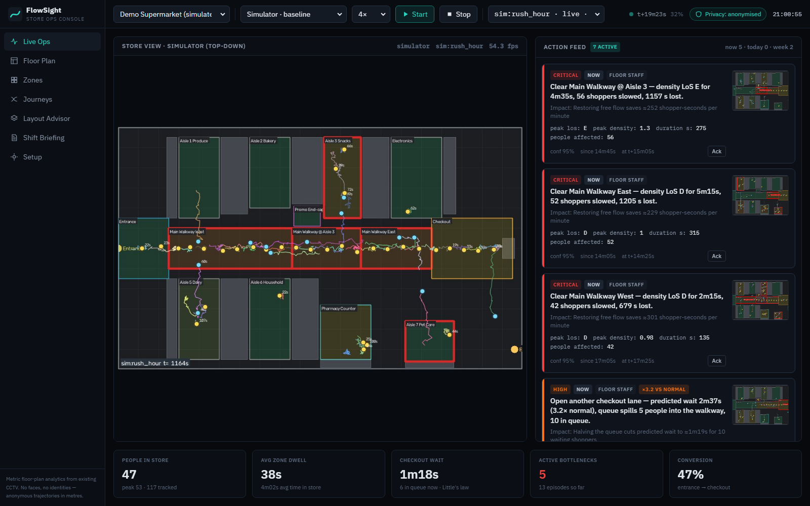

---

## Table of contents

1. [Why FlowSight is different](#1-why-flowsight-is-different)
2. [Quick start: live demo & localhost](#2-quick-start-run-it-on-localhost)
3. [Tour of the Store Ops Console (every page)](#3-tour-of-the-store-ops-console)
   - [3.1 Top bar: stores, sources, runs](#31-top-bar-stores-sources-runs)
   - [3.2 Live Ops: the action feed](#32-live-ops-the-action-feed)
   - [3.3 Floor Plan: live positions & heatmaps](#33-floor-plan-live-positions--heatmaps)
   - [3.4 Zones: dwell, funnels, timelines](#34-zones-dwell-funnels-timelines)
   - [3.5 Journeys: customer paths](#35-journeys-customer-paths)
   - [3.6 Layout Advisor: what-if & layout problems](#36-layout-advisor-what-if--layout-problems)
   - [3.7 Shift Briefing & printable daily report](#37-shift-briefing--printable-daily-report)
   - [3.8 Setup: zone editor & camera calibration](#38-setup-zone-editor--camera-calibration)
4. [Computer-vision pipeline on real CCTV](#4-computer-vision-pipeline-on-real-cctv)
5. [Analytics: exact definitions](#5-analytics-exact-definitions)
6. [Action engine & shift briefing](#6-action-engine--shift-briefing)
7. [Advanced features](#7-advanced-features)
   - [7.1 Multi-camera fusion with automatic calibration](#71-multi-camera-fusion-with-automatic-calibration)
   - [7.2 Staff filtering](#72-staff-filtering)
   - [7.3 Counter-flow conflict detection](#73-counter-flow-conflict-detection)
   - [7.4 ONNX export & CPU-only edge boxes](#74-onnx-export--cpu-only-edge-boxes)
   - [7.5 Tracking metrics on annotated CCTV](#75-tracking-metrics-on-annotated-cctv)
8. [Simulator & accuracy evaluation](#8-simulator--accuracy-evaluation)
9. [Benchmarks](#9-benchmarks)
10. [Architecture & edge-to-cloud deployment](#10-architecture--edge-to-cloud-deployment)
11. [Privacy by design](#11-privacy-by-design)
12. [REST / WebSocket API reference](#12-rest--websocket-api-reference)
13. [Configuration reference](#13-configuration-reference)
14. [CLI & scripts reference](#14-cli--scripts-reference)
15. [Repository layout](#15-repository-layout)
16. [Data sources](#16-data-sources)
17. [Testing](#17-testing)
18. [Limitations & roadmap](#18-limitations--roadmap)
19. [Troubleshooting](#19-troubleshooting)

---

## 1. Why FlowSight is different

Judges at Everseen have seen a hundred "YOLO + heatmap" demos. FlowSight is built around five deliberate choices:

| | Typical "YOLO + heatmap" demo | FlowSight |
|---|---|---|
| **Units** | pixels | **metres on the floor plan** (camera→floor homography). Speeds in m/s, density in people/m², Fruin Level of Service A-F, path length in metres. Analytics never see pixels. |
| **Correctness** | eyeballed | **measured against ground truth**: a shopper simulator with known truth (30 runs, noise + ID breaks injected) and CAVIAR's annotated real CCTV. |
| **Output** | charts | **prioritised actions**: owner, horizon (now / today / this week), evidence, "× vs normal", expected impact, confidence; deduplicated, cooled-down, auto-resolving. |
| **Insight** | "it's busy here" | separates **IGNORED** zones (people pass but don't stop → *merchandising* problem) from **UNVISITED** zones (nobody passes → *layout* problem) using an exposure → entry → stop funnel; estimates the uplift of moving a display (**what-if**). |
| **Deployment** | GPU notebook | existing cameras, **privacy by design** (no faces, no identity), GPU or CPU-only (ONNX), multi-camera fusion with **self-calibration**, edge-to-cloud design that ships only anonymous aggregates. |

---

## 2. Quick start: run it on localhost

### 2.1 The live demo (GitHub Pages)

**https://amartya1056.github.io/flowsight/** hosts the console as a **static replay**. GitHub Pages cannot run the
Python/GPU backend, so `scripts/export_static_demo.py` runs the real pipeline locally and records five runs:

| Run | Source | What to look at |
|---|---|---|
| `demo-rush-hour` | simulator, rush hour (25 min) | the action feed during the queue spill-back, bottlenecks pulsing, the Journeys Sankey |
| `demo-ignored-promo` | simulator, ignored promo (30 min) | the IGNORED promo funnel and the what-if relocation in the Layout Advisor |
| `demo-with-staff` | simulator, 2 employees (45 min) | the "staff excluded / visits purged" KPI |
| `caviar-camera` | **real CCTV** (YOLO11s + ByteTrack, 202 s) | annotated video with blurred heads, the corridor floor plan and heatmaps |
| `caviar-multicam` | **two real cameras**, auto-calibrated + fused (118 s) | both views with shared global IDs and the fused floor plan |

For each run it records the live timeline (positions, zone states, KPIs, the action list whenever it changes) plus
every API response, the evidence snapshots, the daily report, the CSV and the annotated videos. The console is built
with `vite build --mode static`, which reads those files instead of the API and **replays each run in a loop**.
Simulator runs start just before their busiest moment, and camera runs follow the video.

Every page works in the demo: Live Ops, Floor Plan, heatmaps and windows, Zones and drawers, Journeys, Layout Advisor,
Briefing, report and CSV downloads, and the zone editor (editing only). Starting/stopping runs, saving zones and
computing calibrations need the backend, so those buttons are disabled there. To process your own video, run FlowSight
locally (below).

Redeploy after changes:
```bash
python scripts/deploy_pages.py --record
```

### 2.2 Run it on localhost

### Prerequisites
* Python 3.11, Node 18+ (tested with Node 24), `ffmpeg` on `PATH` (for downloading/transcoding clips).
* Optional: NVIDIA GPU + driver (CUDA 12.x wheels are picked automatically); CPU works too.
* Optional: `ANTHROPIC_API_KEY` for an LLM-written shift briefing (a deterministic template is used otherwise).

### Three commands

```bash
make setup
```
Creates the virtualenv (automatically outside OneDrive/Dropbox folders), installs CUDA or CPU PyTorch and all Python
deps, downloads the YOLO11n/s weights, and runs `npm install` for the console.

```bash
make data
```
Downloads the real CCTV test footage (CAVIAR shopping-centre corridor + front views, ground-truth XML, MOT17/MOT20
crowd videos), converts it to MP4 and draws the floor-plan images.

```bash
make demo
```
Builds the console (once), starts the API on **http://127.0.0.1:8000** and auto-starts two live runs (the `rush_hour`
simulator at 4× and the real CAVIAR camera), so the console is alive within seconds. Works fully offline once the
weights are cached.

> **Windows without `make`:** every target is a thin wrapper around `python scripts/tasks.py <target>`:
> ```bash
> python scripts/tasks.py demo
> ```

Then open **http://127.0.0.1:8000** in a browser. Use the top bar to start more runs: any simulator scenario, any
camera, or *Multi-camera fusion* for the two-camera store.

### Development mode (hot reload)

```bash
make api
```
```bash
make web
```
`make api` serves the API on :8000; `make web` serves the console with Vite on **http://localhost:5173** (proxied to the API).

---

## 3. Tour of the Store Ops Console

The console is a React + TypeScript + Tailwind single-page app (ECharts for charts, plain `<canvas>` for the floor plan),
fed by one WebSocket per run (`useLiveRun`) plus React-Query REST calls. It has seven pages.

### 3.1 Top bar: stores, sources, runs

| Control | What it does |
|---|---|
| **Store selector** | `Demo Supermarket (simulated)`, `Shopping Centre Corridor (CAVIAR, real CCTV)`, `Shopping Centre Corridor: 2 cameras (CAVIAR)`. |
| **Source selector** | A real camera (`Camera · …`), **Multi-camera fusion** (stores with ≥ 2 calibrated cameras), or a simulator scenario (`baseline`, `rush hour`, `blocked aisle`, `ignored promo`, `dead aisle`, `with staff`). |
| **Speed** | 1×, 2×, 4× or `max` (as fast as the hardware allows). |
| **Start / Stop** | `POST /api/runs` / `DELETE /api/runs/{id}`. Each run writes its own DuckDB file under `runs/<run_id>/`. |
| **Run selector** | Switch between live and finished runs; switching a run also switches the store context. |
| **Status** | Live dot, simulated/video time (`t+19m23s`), progress %, a permanent **Privacy: anonymised** badge, wall clock. |

### 3.2 Live Ops: the action feed


**Left: the live view.** For the simulator this is a top-down render of the store. Each shopper is a dot (**teal** =
walking, **amber** = stopped/browsing below 0.3 m/s) with a short trail and a live dwell label. Zones are tinted by
their live Fruin LoS, and **zones with an active bottleneck pulse red**. In the shot above, the rush-hour checkout queue
has spilled back along the whole main walkway and all three walkway segments are flagged.

**Right: the action feed.** Prioritised, deduplicated insight cards. Anatomy of a card:

| Element | Example | Meaning |
|---|---|---|
| Severity chip | `CRITICAL` | critical / high / medium / low (colour-coded bar on the left) |
| Horizon chip | `NOW` | now / today / this week |
| Owner chip | `FLOOR STAFF` | floor staff / store manager / merchandising / layout planning |
| Ratio chip | `×3.2 VS NORMAL` | value vs the zone's own rolling baseline |
| Action | *Open another checkout lane: predicted wait 2m37s …* | one imperative sentence carrying the evidence numbers |
| Impact | *Halving the queue cuts predicted wait to ≈1m19s for 10 waiting shoppers* | expected effect of acting |
| Metrics | `peak los: E · peak density: 1.3 · people affected: 56` | the evidence |
| Footer | `conf 95% · since 14m45s · at t+15m05s · Ack` | confidence, time window, creation time, acknowledge |
| Thumbnail | (right) | a **privacy-blurred evidence snapshot** with the zone highlighted, saved when the insight fired |

**Bottom: KPI strip.** People in store (peak, tracked, staff excluded), average zone dwell and time in store, checkout
wait (Little's law), active bottlenecks (and episodes so far), entrance→checkout conversion.

**On real CCTV** the left panel becomes the annotated camera stream (MJPEG). It shows person boxes with **global IDs**,
live dwell (`#5 3s`), the floor zones projected back into the camera with their live occupancy, and the HUD (time,
people, FPS, calibration status, privacy). **Every head is blurred** before the frame leaves the pipeline:

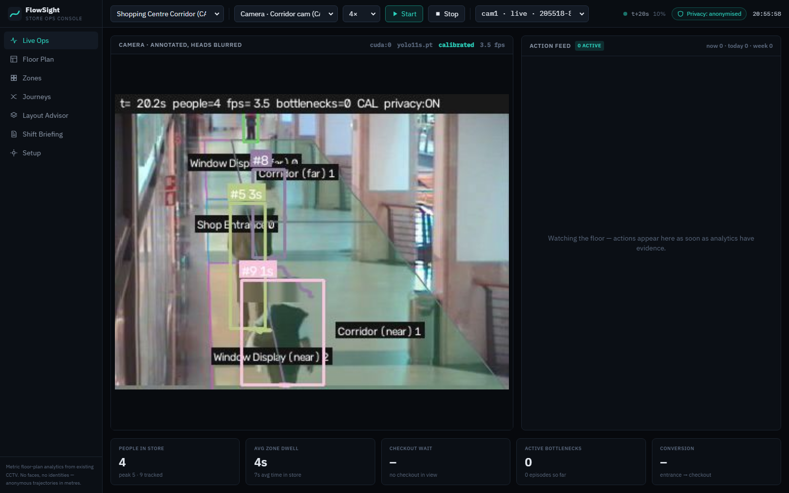

**Multi-camera fusion** shows both cameras side by side, with the *same* global IDs across views, and the fused floor
plan on the right (see [§7.1](#71-multi-camera-fusion-with-automatic-calibration)):

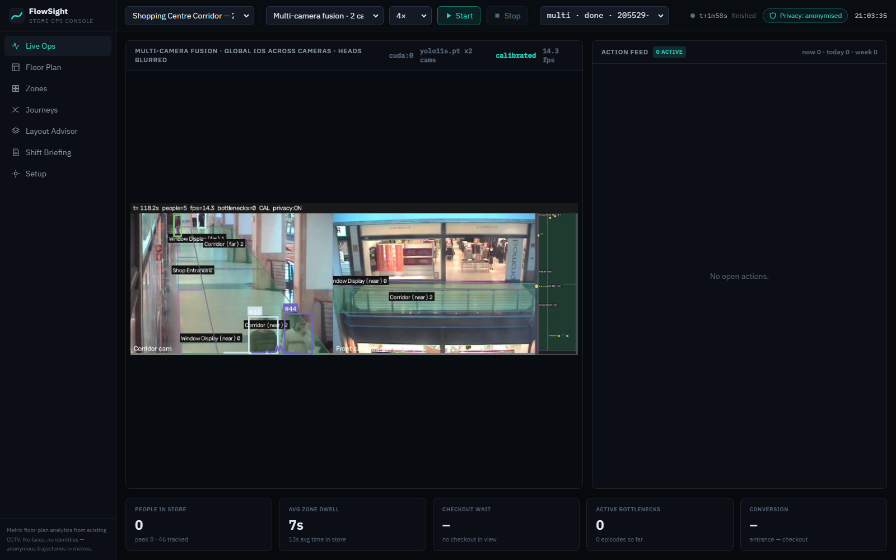

### 3.3 Floor Plan: live positions & heatmaps

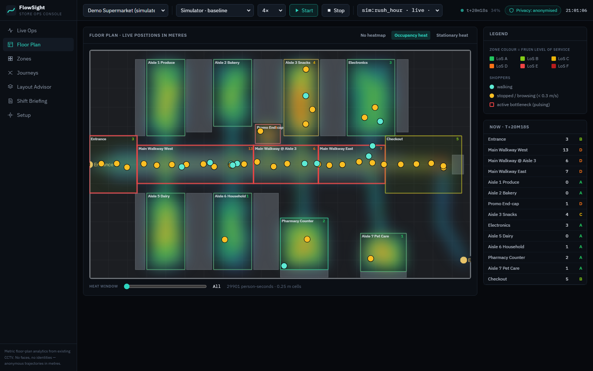

* Live shopper positions **in metres** on the floor plan; zones coloured by **Fruin Level of Service** (legend on the right).
* **Occupancy heat**: person-seconds per 0.25 m cell (time-weighted, so it does not depend on frame rate).
* **Stationary heat**: only time spent below 0.3 m/s: *where people actually stop*, not just where they walk.
* **Heat window slider**: all time, or the last 5 / 15 / 30 / 60 minutes (one grid bucket per minute).
* **"Now" table**: current occupancy and LoS of every zone.

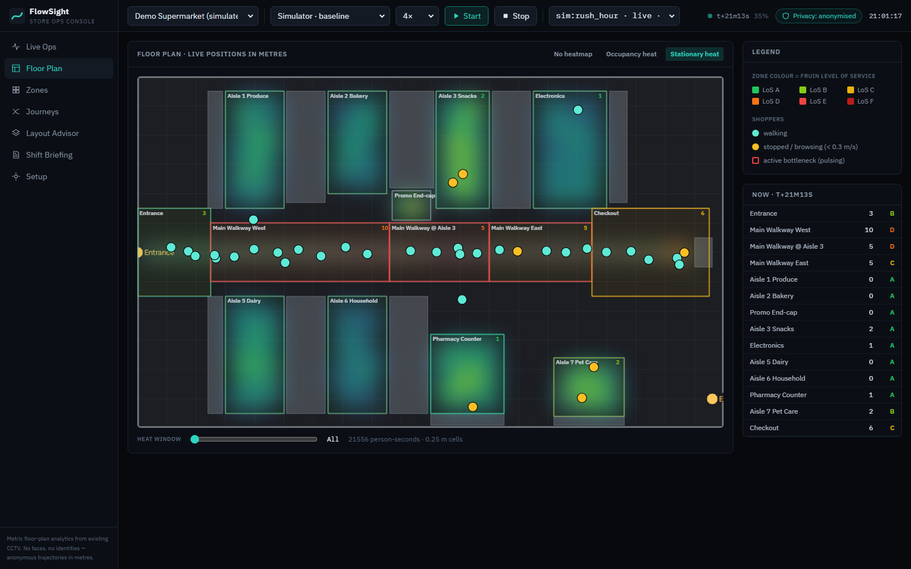

Hovering a zone opens a tooltip with live and cumulative KPIs. Here the walkway in front of Aisle 3 is at LoS D with an
active bottleneck:

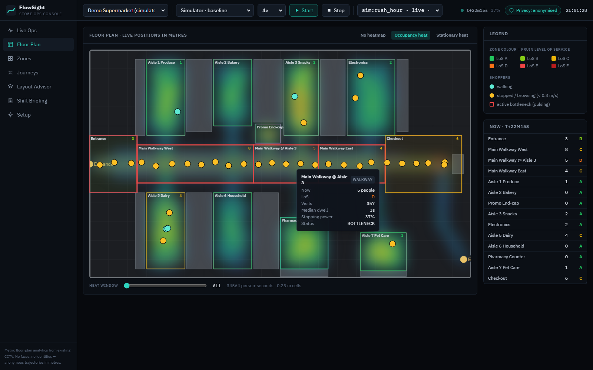

The same page works for the real camera store. Its floor plan is the shopping-centre corridor (4.5 × 16 m), with the
shop front on the left and the atrium railing on the right:

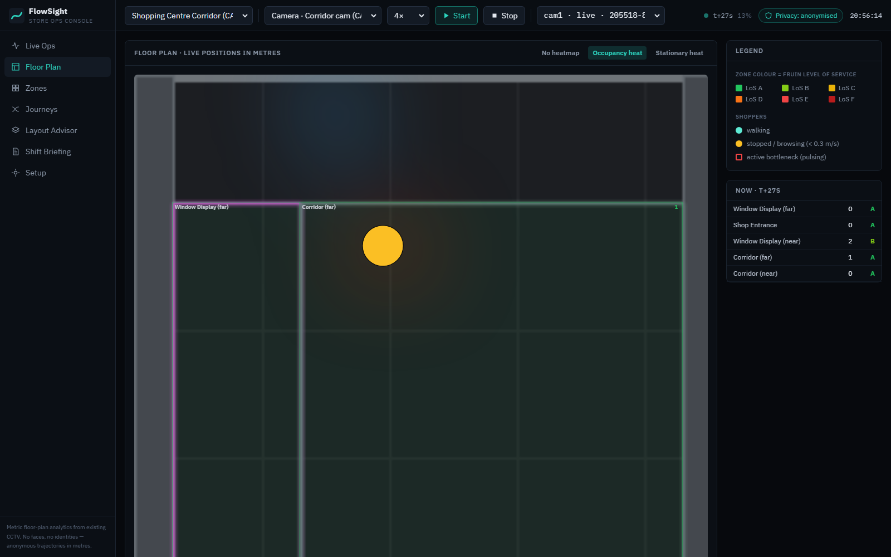

### 3.4 Zones: dwell, funnels, timelines

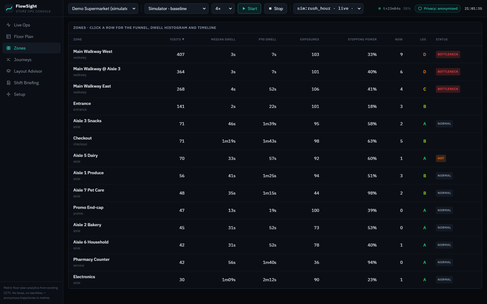

A sortable table of every zone: visits, median and P90 dwell, exposures, stopping power, current occupancy, live LoS
and a **status badge** (`HOT`, `IGNORED`, `UNVISITED`, `NORMAL` or `BOTTLENECK`).

Clicking a row opens the **zone drawer** with:
1. **Attention funnel** (last 15 min): exposures → entries → stops (≥ 3 s engaged), plus stopping power.
2. **Dwell-time distribution** of completed visits.
3. **Occupancy timeline** with **bottleneck periods shaded red**.

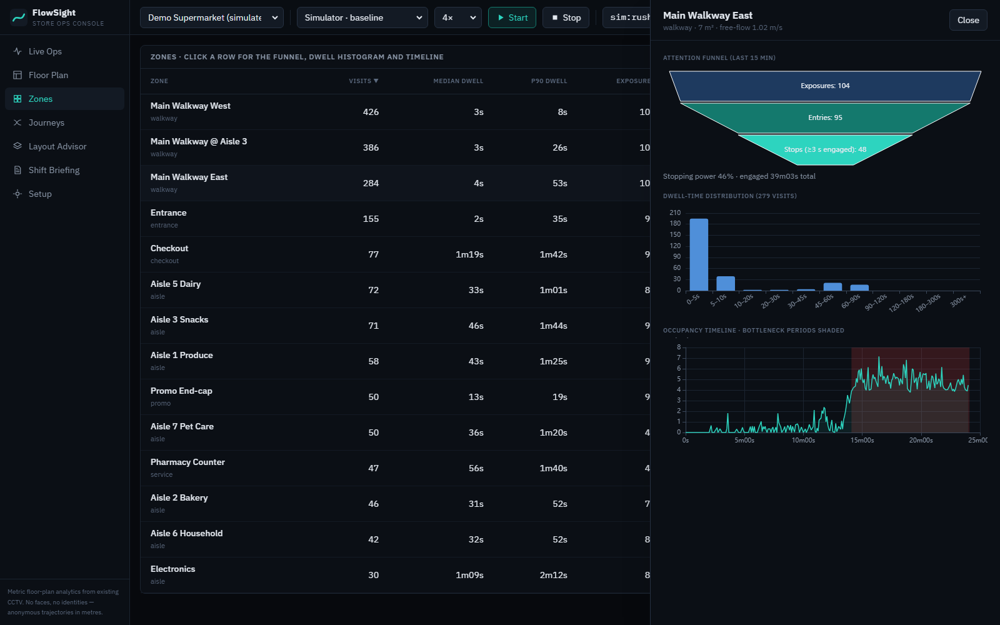

The funnel is what separates *merchandising* from *layout* problems. In the `ignored_promo` scenario the promo end-cap
sits on the busiest path: 47 shoppers were exposed to it, **0 entered and 0 stopped**, so it is flagged **IGNORED**:

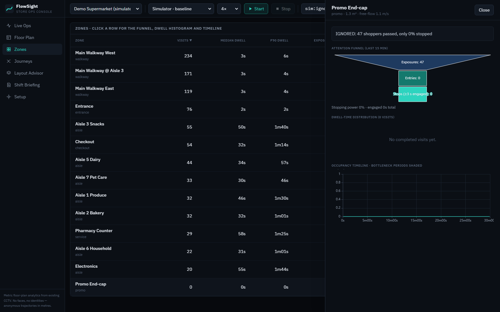

### 3.5 Journeys: customer paths

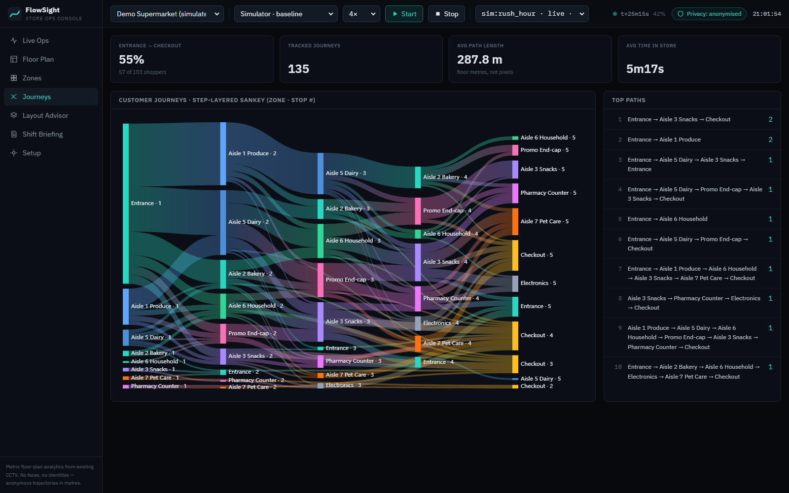

* **Step-layered Sankey** of zone-to-zone transitions ("Aisle 3 · 2" = Aisle 3 as the 2nd stop). Layering keeps the
  graph acyclic, and walkways are excluded so paths read as *destinations*.
* **Top-10 paths** with counts.
* KPIs: entrance → checkout **conversion**, tracked journeys, average **path length in metres**, average time in store.

### 3.6 Layout Advisor: what-if & layout problems

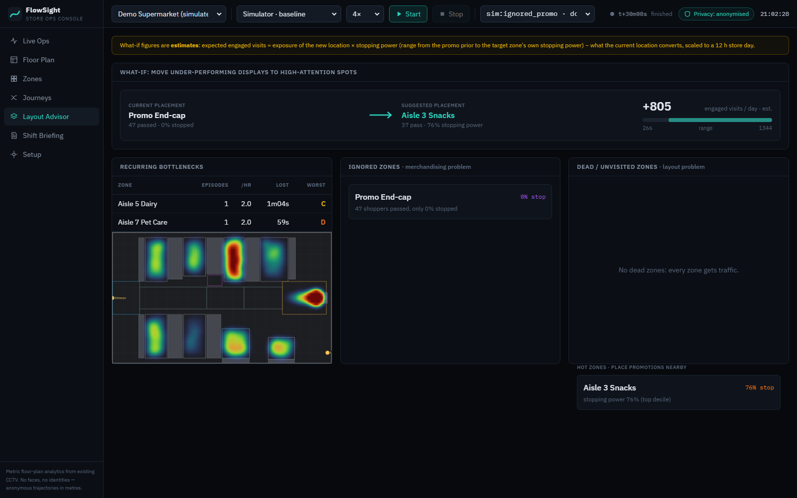

* **What-if relocation:** for every IGNORED/UNVISITED promo and every HOT zone, the estimated gain from moving the
  display. *Expected engaged visits = exposure(new spot) × stopping power − what the current spot converts*, scaled to a
  12 h store day. It is shown as a range (from the promo prior to the target zone's own stopping power) and is always
  labelled an **estimate**.
* **Recurring bottlenecks:** episodes, rate per hour, time lost and worst LoS per zone, with the stationary heatmap.
* **Ignored zones** (merchandising problem), **dead/unvisited zones** (layout problem) and **hot zones** (place promotions
  nearby). HOT requires top-decile stopping power *and* being on a busy path.

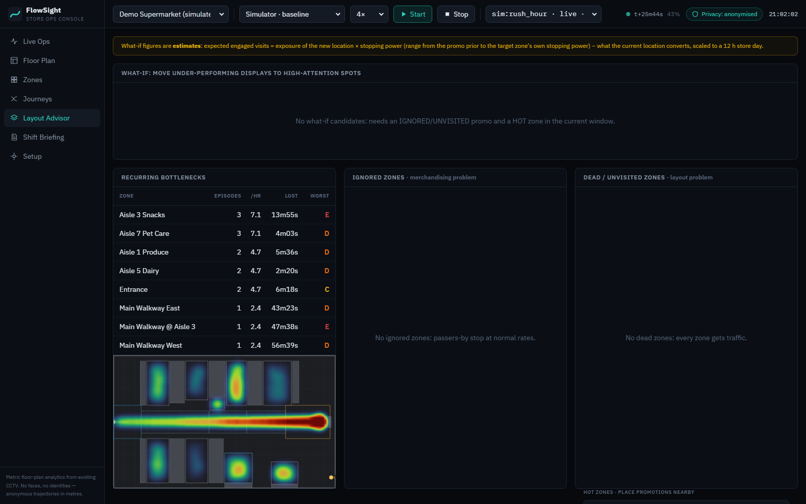

### 3.7 Shift Briefing & printable daily report

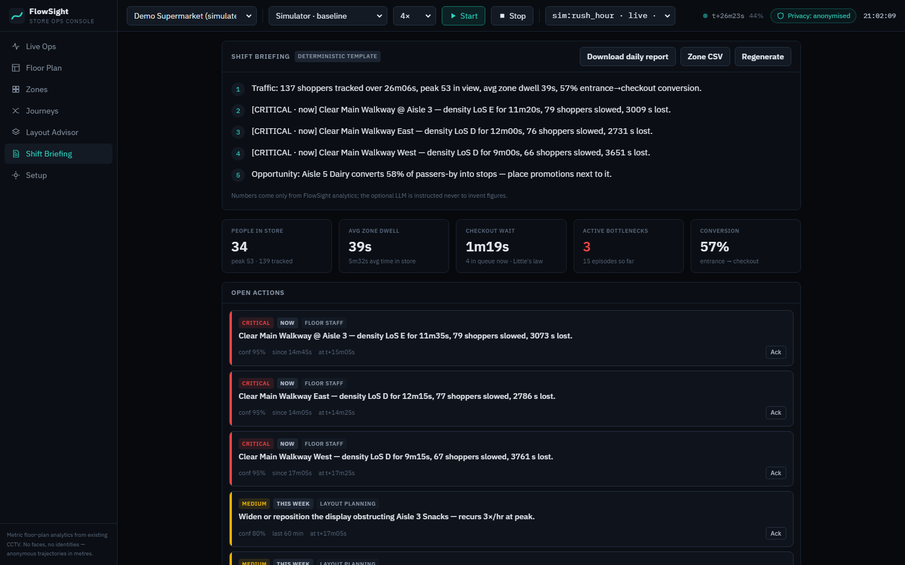

Five bullets for the shift manager: traffic and conversion, the most urgent actions, and one opportunity.
* With `ANTHROPIC_API_KEY` set, Claude rewrites the facts under a strict *"use only the supplied JSON, never invent
  numbers"* prompt (model configurable).
* Otherwise, or on any error, a deterministic template is used, so **it always works offline**.

The chip at the top shows which mode produced the text. Buttons export the **daily report** (`report.html`,
print-ready) and a **zone CSV**.

<details>
<summary><b>Printable daily report (report.html): click to expand</b></summary>

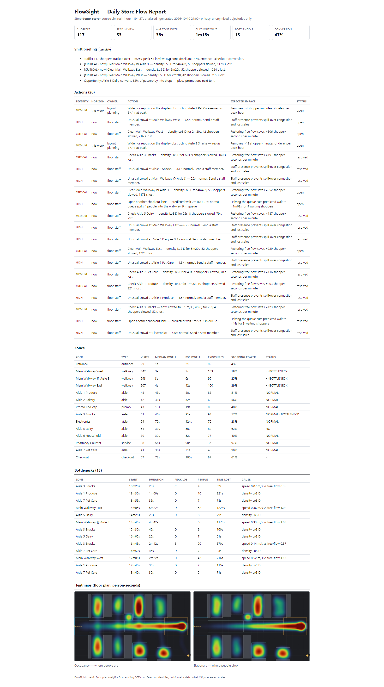

</details>

### 3.8 Setup: zone editor & camera calibration

**Zone editor:** draw polygons on the floor plan in metres (snapping to 5 cm), drag vertices, rename, change the type
(`entrance · aisle · promo · walkway · checkout · service`; the rules depend on the type), delete, and save straight to
`config/stores/<store>.yaml`.

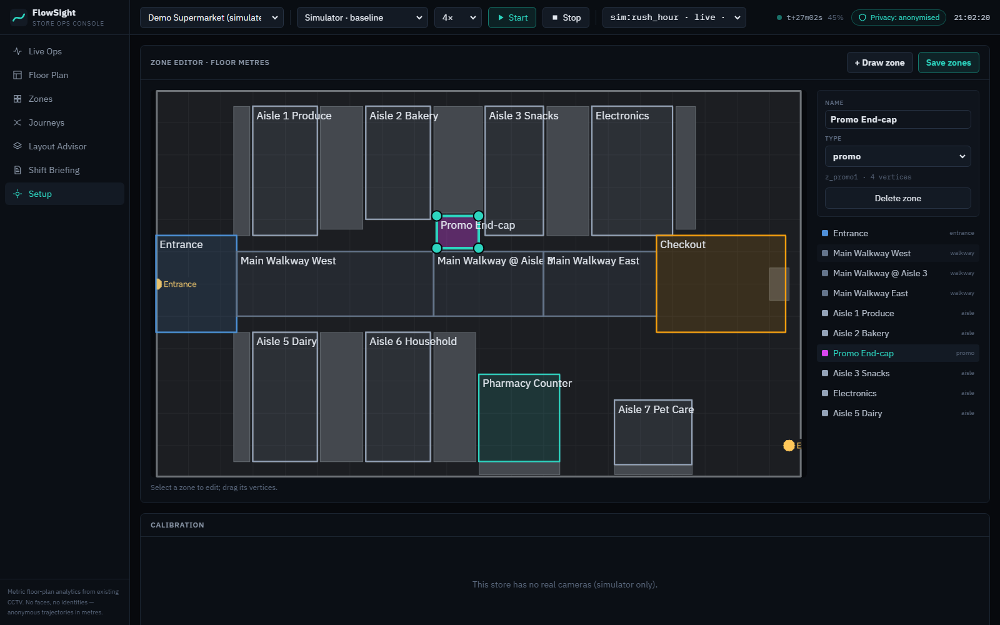

**Camera calibration:**
1. Click ≥ 4 floor points on the (head-blurred) first frame and type their floor coordinates in metres.
2. **Compute** shows the reprojection error and a **warped preview** (the camera image warped onto the floor plan).
3. **Save** writes the homography points to the store config.

The same flow is available from the terminal with `flowsight calibrate` (OpenCV click UI).

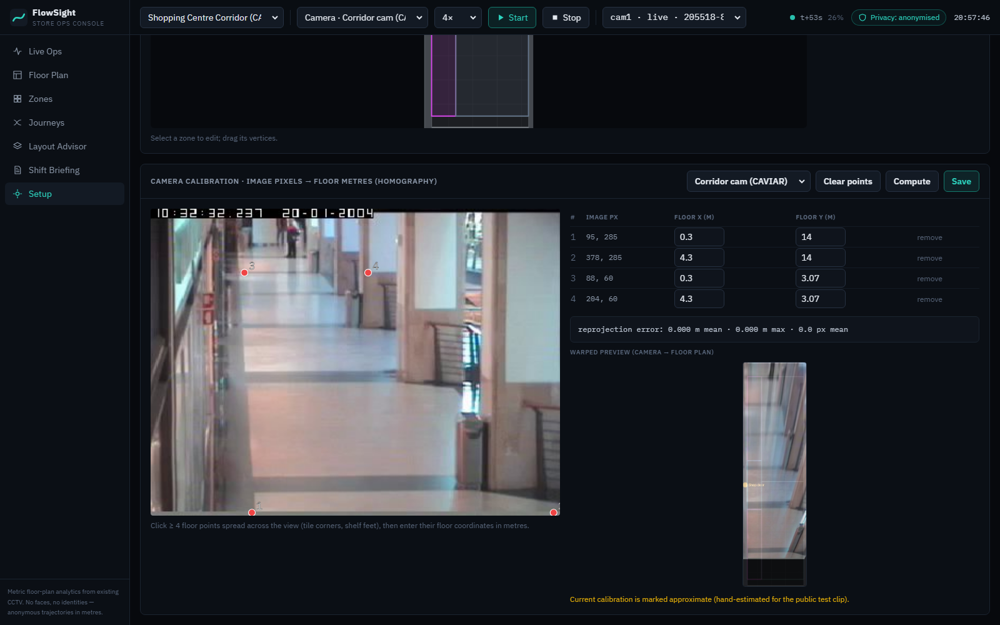

---

## 4. Computer-vision pipeline on real CCTV

```
frame ─► YOLO11 person detector ─► ByteTrack ─► foot point ─► homography (px → m) ─► TrackStore ─► analytics hub
                                        │                                                   │
                                        └──────────► head blur ─► renderer ─► MJPEG / MP4 / evidence
```

| Stage | Implementation |
|---|---|
| **Video source** | File, RTSP/HTTP URL or webcam index; decimated to `target_fps` (10). Timestamps come from the source FPS, so analytics are reproducible regardless of processing speed. |
| **Detection + tracking** | Ultralytics **YOLO11s** (GPU, FP16) or **YOLO11n** (CPU), class *person* only, built-in **ByteTrack** (`persist=True`); BoT-SORT selectable in config. The device is auto-selected (CUDA → MPS → CPU) and logged. |
| **Foot point** | Bottom-centre of the box. If the box touches the bottom edge (feet not visible), the foot is estimated from the box top plus that track's **median untruncated height**. |
| **Floor projection** | `cv2.findHomography` (RANSAC when ≥ 5 points), with reprojection error reported. **Fallback when uncalibrated:** auto-scale from person heights (box height ≈ 1.70 m, fitted linearly against image row) gives approximate metric positions and speeds; the run is flagged UNCALIBRATED. |
| **TrackStore** | EMA smoothing (α = 0.4); speed over a 1 s window, **de-biased for position noise** (a standing person otherwise "moves" ≈ 0.13 m/s); heading; maturity (≥ 1 s); and **ID stitching**: a new tracker ID appearing ≤ 2 s after a track was lost, within 1.2 m of its constant-velocity prediction and not behind it, inherits the old ID. |

Real CAVIAR shopping-centre footage, annotated by FlowSight (global IDs, live dwell, projected zones with live counts,
heads blurred):

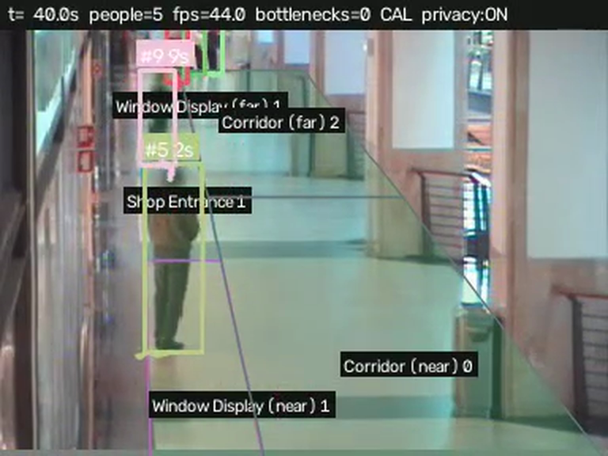

Close-up of the irreversible head blur (pixelate + Gaussian on the top 22 % of every person box):

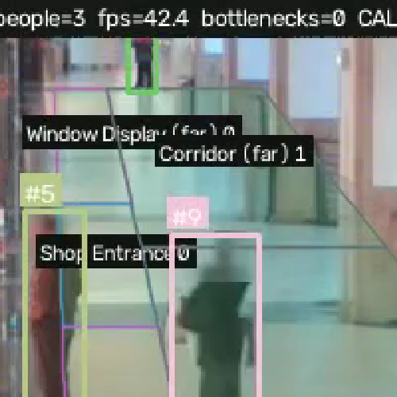

Heatmaps are computed on the floor. They can be **projected back into the camera view** with the inverse homography,
or shown on the floor plan:

| Camera-view occupancy | Camera-view stationary | Floor-plan occupancy |
|---|---|---|
| 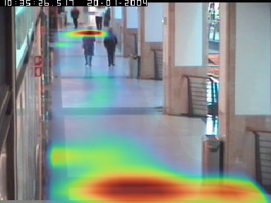 | 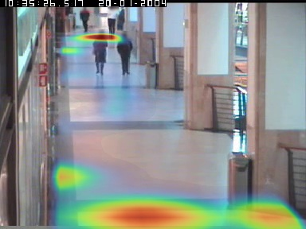 | 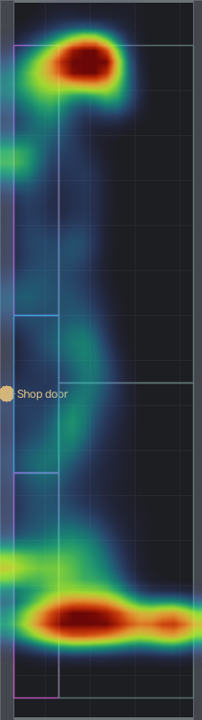 |

`flowsight process --store caviar_corridor --camera cam1` writes everything for a clip to `runs/<id>/`:
`annotated.mp4` (H.264), `sample.jpg`, `heatmap_{occupancy,stationary}.png` (+ `_camera.jpg`), `evidence/*.jpg`,
`flowsight.duckdb`, `parquet/*.parquet` and `summary.json`.

---

## 5. Analytics: exact definitions

All analytics consume **floor-coordinate track points with timestamps**, never pixels. That is why one analytics hub
serves video, multi-camera and simulator runs, and why the simulator can validate it exactly.

| Metric | Definition |
|---|---|
| **Visit** | Debounced per-(track, zone) state machine `OUTSIDE → ENTERING → INSIDE → EXITING → OUTSIDE`. A visit starts after ≥ 1.0 s inside and ends after ≥ 1.5 s outside, so boundary jitter never creates extra visits. |
| **Dwell** | last inside timestamp − first inside timestamp of a visit. |
| **Engaged dwell** | time inside moving < 0.3 m/s (de-biased speed). |
| **Stop** | a visit with ≥ 3 s engaged. |
| **Exposure** | a unique shopper who entered the zone *or its 1.5 m exposure buffer* in the window (could have seen it). |
| **Stopping power** | stopping shoppers / exposed shoppers (rolling 15 min). |
| **UNVISITED** | merchandisable zone with exposure < 20 % of the median zone → *layout / wayfinding problem*. |
| **IGNORED** | normal exposure (≥ 30 shoppers) but stopping power < 8 % → *merchandising / display problem*. |
| **HOT** | top-decile stopping power **and** ≥ 75 % of median traffic → *place promotions nearby*. |
| **Heatmap** | person-seconds per 0.25 m cell (`+dt` per person per frame); the stationary variant counts only time below 0.3 m/s; rolling buckets per minute. |
| **Density / LoS** | mean people ÷ zone area per 5 s window → area per person → Fruin LoS: A ≥ 3.3, B ≥ 2.3, C ≥ 1.4, D ≥ 0.9, E ≥ 0.5 m²/person, else F. |
| **Free-flow speed** | per zone, p75 of individual speeds observed while the zone was at LoS A/B (1.1 m/s until learned). |
| **Bottleneck** | walkway/entrance/aisle zone with **LoS ≥ D**, or **speed < 50 % of free-flow with ≥ 3 people**, sustained ≥ 20 s. Aisles additionally need LoS ≥ C for the speed rule, because slow in an aisle is just browsing. An episode ends after 2 clear windows (hysteresis). |
| **Time lost** | Σ dt · max(0, 1 − v / v_free) over everyone in the zone during the bottleneck (actual − free-flow traversal time). |
| **Queue** | L = slow people in the checkout zone; λ = entries/s over 5 min; **W = L / λ (Little's law)**, cross-checked against observed checkout dwell. For a new arrival, FlowSight also computes (L + spill-over) / μ, counting people stationary in the configured overflow walkway. |
| **Baselines** | rolling mean/std per zone and metric (360 windows); z-scores and "× normal" ratios. |
| **Flow** | ordered zone sequence per track (walkways excluded), transitions, top paths, conversion, path length (m), time in store. |
| **Counter-flow** | per window: 8-bin heading entropy + counter-flow ratio along the zone's long axis (see [§7.3](#73-counter-flow-conflict-detection)). |

**Storage:** one **DuckDB** file per run with tables `runs, frames, track_points (2 Hz), visits, zone_windows,
bottlenecks, conflicts, attention_windows, queue_windows, insights`. Rows are batch-inserted every second and exported
to Parquet at the end.

---

## 6. Action engine & shift briefing

Rules (each unit-tested) turn analytics state into candidate insights keyed by *(rule, zone)*:

| Rule | Trigger | Horizon / owner | Example action |
|---|---|---|---|
| Checkout queue | predicted wait > 180 s, or queue rising 3 windows in a row (L ≥ 2) | now · floor staff | *Open another checkout lane: predicted wait 2m37s (3.2× normal), queue spills 5 people into the walkway, 10 in queue.* |
| Active bottleneck | bottleneck active in walkway/entrance (aisle = "check") | now · floor staff | *Clear Main Walkway East: density LoS D for 5m15s, 52 shoppers slowed, 1205 s lost.* |
| Recurring bottleneck | ≥ 3 episodes in a zone within the last hour | this week · layout planning | *Widen or reposition the display obstructing Main Walkway East: recurs 5×/hr at peak.* |
| Counter-flow conflict | sustained (≥ 60 s) or recurring two-way conflict | this week · layout planning | *Two-way conflict in Main Walkway @ Aisle 3: 50% of walkers move against the main flow at LoS D for 1m25s. Add one-way guidance or a centre divider.* |
| Ignored zone | IGNORED status | today · merchandising | *Promo End-cap: 212 shoppers passed, only 3% stopped. Refresh signage / swap product.* |
| Unvisited zone | UNVISITED status | this week · layout planning | *Aisle 7 receives 12% of median traffic. Add wayfinding or move a traffic-driver product there.* |
| What-if | IGNORED/UNVISITED promo + HOT zone | this week · merchandising | *What-if: moving the promo to Aisle 3 Snacks (stopping power 76%) ≈ +805 engaged visits/day (range 266-1344, estimate).* |
| Occupancy anomaly | 30 s-smoothed occupancy z > 3, ≥ 2× normal, ≥ 4 people | now · floor staff | *Unusual crowd at Electronics: 3.4× normal. Send a staff member.* |
| Assist shopper | one shopper stationary > 120 s in a service/aisle zone | now · floor staff | *Shopper waiting at Pharmacy Counter for 2m10s: assist.* |

**Engine behaviour**
* **Dedup:** an active *(rule, zone)* is updated in place, never duplicated.
* **Hysteresis:** a condition must stay clear for 30 s before the insight auto-resolves (no flapping).
* **Cooldown:** a resolved key cannot re-fire for 5 minutes.
* **Cap:** at most 12 active insights. **Priority** = severity weight × confidence × (1 + ln(1 + people affected)).
* **Evidence:** a privacy-blurred snapshot with the zone highlighted is saved when an insight is created.
* **Ack:** acknowledged insights stay visible until resolved.

---

## 7. Advanced features

### 7.1 Multi-camera fusion with automatic calibration

**Fusion** (`flowsight/tracking/fusion.py`). Every camera projects its detections onto the *same* floor plan. Each frame,
observations are Hungarian-matched across cameras within a 1 m gate, and each cluster carries a persistent **fused key**.
That key is the hand-off mechanism: camera B's tracker ID is bound to the key camera A's track already holds, so when A
loses the shopper, B continues the **same global track**. Fused observations feed one global TrackStore, whose stitching
also bridges short gaps between non-overlapping views. **No appearance features** are used.

**Self-calibration** (`flowsight/geometry/autocalib.py`, `scripts/autocalibrate.py`). A new camera is calibrated from a
few minutes of ordinary traffic seen by an already-calibrated neighbour, with no survey and no clicking:
1. Run the production detector + tracker on both clips, and repair the feet of boxes cut off by the frame edge. That
   is exactly where these two views overlap.
2. Keep only **walking** people. Standing people fit *any* clock offset and attract degenerate solutions.
3. For each candidate clock offset, pair every walking foot point of the new camera with every walking floor position
   of the reference camera. A guarded **LO-RANSAC** (4 samples from 4 different frames; fold/area/convexity checks;
   per-detection capped score) finds the homography. The offset with the most inliers wins (best of 3 seeds).

| Result on the real CAVIAR pair | Value |
|---|---|
| Recovered clock offset | **70 frames = 2.8 s** (stable across seeds and both clip pairs) |
| Validation vs ground truth (both views annotated independently) | every front-view person maps to a distinct corridor-view person; median trajectory agreement ≈ **0.3 m** |
| Live fusion | **31.5 FPS** for 2 cameras on an RTX 4060 · 42 + 22 per-camera identities → 52 fused · 12 seen by both cameras · 2 full hand-offs · cross-camera agreement **0.31 m** median |

The corridor zones (defined once on the floor plan) projected into the front camera with the recovered homography:


The fused output: both cameras with shared global IDs, plus the fused floor plan:

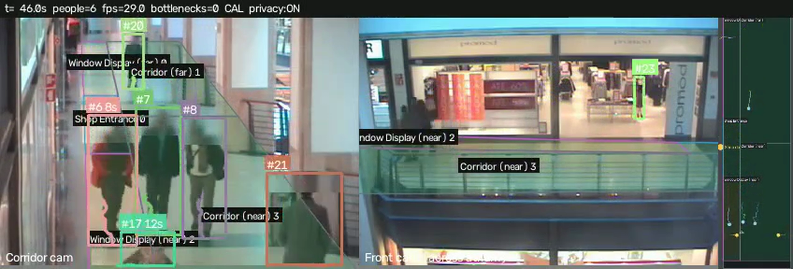

Details and the per-person validation table: [docs/multicam_autocalib.md](docs/multicam_autocalib.md).

### 7.2 Staff filtering

Employees would inflate dwell and visits, so FlowSight keeps them out of shopper analytics using two privacy-preserving
cues:
* **Long presence:** on the floor ≥ 30 min. *Presence lineage* carries a person's presence time across tracker breaks
  (gap ≤ 30 s; distance gate = walking speed × gap, within 2.5-5 m; never at entrances), so a broken track does not
  reset an employee's clock.
* **Uniform colour** (optional): `staff_uniform_hsv` ranges. A track is staff when the mean fraction of torso pixels
  inside the range is ≥ 35 % over ≥ 10 observations. Only colour statistics of the torso are used, never faces.

When a track is flagged, its visits, exposures, trajectory rows *and those of its earlier fragments* are purged
retroactively. The KPI tile shows how many staff are excluded and how many visits were purged:

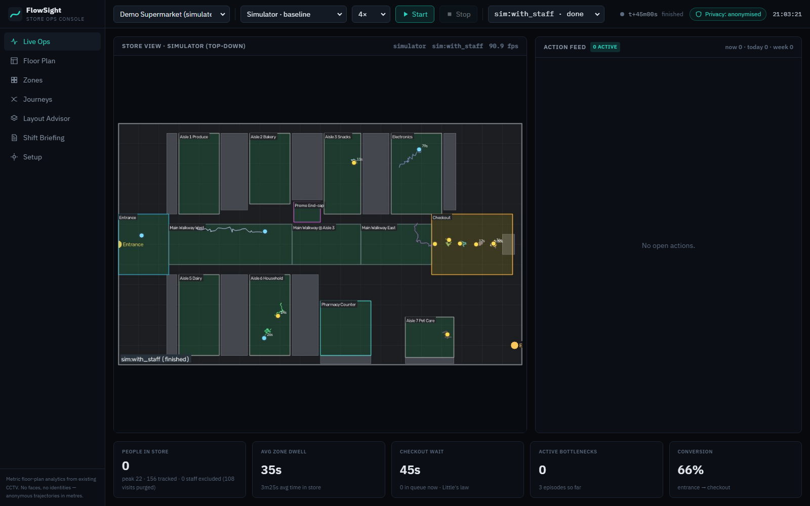

In the `with_staff` simulation (2 employees restocking for 45 min), 4 of 5 seeds leave 0-1 staff visits in the
analytics, and **no shopper is ever mis-flagged** in the baseline or rush-hour runs.

### 7.3 Counter-flow conflict detection

For walkers (> 0.3 m/s) in each 5 s window, FlowSight computes:
* **Direction entropy:** 8 heading bins, normalised Shannon entropy.
* **Counter-flow ratio:** velocities projected on the zone's long axis, min(n₊, n₋) / (n₊ + n₋). 0 = one-way, 0.5 = perfectly two-way.

A **conflict** is a counter-flow ratio ≥ 0.3 at LoS ≥ C for ≥ 30 s in a walkway or entrance. Dead-end aisles are two-way
by nature, so they are excluded. Entropy alone is not used as the gate, because a clean two-way stream only scores
~0.33. The layout insight fires for sustained (≥ 60 s) or recurring (≥ 2/hr) conflicts.

Illustration: a two-way stream run through the real analytics hub and action engine (`python scripts/counterflow_demo.py`):

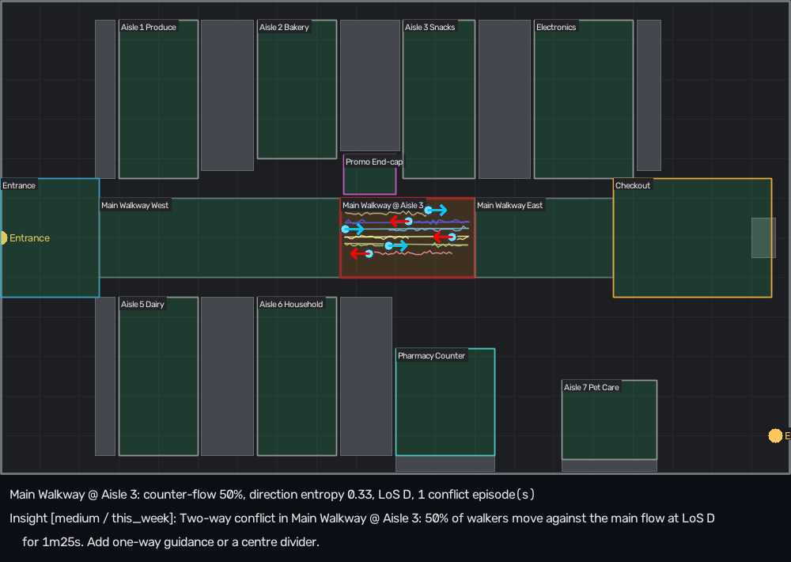

### 7.4 ONNX export & CPU-only edge boxes

`python scripts/export_onnx.py` exports YOLO11n/s to static-shape ONNX. Setting `runtime.model_cpu: yolo11n_640.onnx`
runs the same pipeline: Ultralytics' `.track()` API, ByteTrack and everything downstream are unchanged.

| Detector only, CPU (i7-13700HX), imgsz 640 | FPS |
|---|---|
| yolo11n PyTorch → ONNX Runtime | 33.7 → 34.9 |
| yolo11s PyTorch → ONNX Runtime | 15.2 → 16.4 |
| **Full pipeline on CPU only** (yolo11n ONNX + tracking + analytics + blur + render) | **24.6** |

A GPU-less edge box therefore runs the full pipeline at 2.5× the 10 FPS analytics rate.

### 7.5 Tracking metrics on annotated CCTV

`python -m flowsight.cli mot` scores the perception layer on CAVIAR's annotated corridor sequences (every frame,
IoU ≥ 0.5, `motmetrics`). It compares raw ByteTrack IDs with FlowSight's stable IDs on the *same* boxes:

| Mean of 3 sequences | MOTA | IDF1 | ID switches (total) |
|---|---|---|---|
| ByteTrack (raw) | 0.700 | 0.668 | 39 |
| **FlowSight (with ID stitching)** | 0.700 | **0.699** | **27 (−31 %)** |

Per-sequence numbers: [docs/tracking_metrics.md](docs/tracking_metrics.md). Misses are dominated by people ~10 px wide
at the far end of the 384 × 288 corridor view.

---

## 8. Simulator & accuracy evaluation

**Simulator** (`flowsight/sim/simulator.py`). An agent-based supermarket (20 × 12 m, 14 zones):
* Shoppers arrive (Poisson, time-varying) and draw a shopping list weighted by zone attractiveness.
* They walk a waypoint graph (per-agent lanes, Weidmann density slow-down) and browse with lognormal dwell.
* They queue at a single-server checkout, then leave.

The measured path sees realistic tracker errors: **σ = 0.15 m position noise, 2 % dropouts and random ID breaks**.

| Scenario | What it stresses |
|---|---|
| `baseline` | normal trading |
| `rush_hour` | arrivals 3 → 8/min; the queue spills into the main walkway |
| `blocked_aisle` | an obstacle narrows the centre walkway |
| `ignored_promo` | a promo on the busiest path that nobody stops at |
| `dead_aisle` | an aisle off every path that nobody visits |
| `with_staff` | 2 employees on the floor for the whole 45-minute run |

**Method.** Each run feeds two analytics hubs in lock-step:
* the **oracle**, fed perfect data (true positions, speeds and identities);
* the **measured** pipeline (noisy observations → real TrackStore).

Ground truth applies the same metric definitions to perfect data, so the comparison isolates measurement robustness.
Zone classification is scored against the scenario's intent.

`make eval` → [runs/eval/report.md](runs/eval/report.md): 6 scenarios × 5 seeds × 30 sim-minutes (45 for `with_staff`):

| Scenario | Visit F1 | Dwell MAE | BN recall (sustained ≥ 60 s) | BN recall (all) | BN precision | Zone classification | Queue-wait MAE |
|---|---|---|---|---|---|---|---|
| baseline | 0.966 | 0.21 s | n/a | 0.44 | 0.80 | 100 % | 7.9 s |
| rush_hour | 0.928 | 0.32 s | **1.00** | 0.82 | 0.94 | 100 % | 10.8 s |
| blocked_aisle | 0.936 | 0.28 s | **1.00** | 0.75 | 0.99 | 100 % | 12.9 s |
| ignored_promo | 0.969 | 0.19 s | n/a | 0.72 | 0.50 | 100 % (promo → IGNORED) | 8.7 s |
| dead_aisle | 0.970 | 0.22 s | 1.00 | 0.60 | 0.60 | 100 % (aisle 7 → UNVISITED) | 8.6 s |
| with_staff | 0.956 | 0.22 s | 1.00 | 0.53 | 0.78 | 100 % | 7.2 s |
| **all** | **0.954** | **0.24 s** | **1.00** | 0.64 | 0.78 | **100 %** | 9.3 s |

| Target | Result |
|---|---|
| Dwell MAE < 1.5 s | ✅ 0.24 s |
| Visit F1 > 0.9 | ✅ 0.954 |
| Ignored / unvisited zones correctly classified | ✅ 100 % of seeds |
| Bottleneck recall ≥ 0.9 on rush_hour | ✅ 1.00 for sustained jams (≈ 4 s latency) · ❌ 0.82 when counting 20-40 s aisle crowds that sit exactly on the threshold |

Track fragmentation is 1.07 stable IDs per true shopper; ~290 ID breaks per run are repaired by stitching.

---

## 9. Benchmarks

Full tables: [docs/benchmarks.md](docs/benchmarks.md) (Intel i7-13700HX + RTX 4060 Laptop GPU).

| Stage | Throughput |
|---|---|
| YOLO11s @960 FP16 + ByteTrack (CAVIAR 384 × 288) | **73 FPS** (13.6 ms/frame) |
| YOLO11s @960 FP16 + ByteTrack (MOT20 1080p, ~16 people) | **67 FPS** |
| Full single-camera pipeline (detector → analytics → blur → render → MP4) | **46 FPS** |
| Two-camera fusion pipeline | **31.5 FPS** |
| CPU only, yolo11n ONNX, full pipeline | **24.6 FPS** |
| Analytics only (20 / 200 people per frame) | **0.7 / 2.5 ms** per frame |

At 10 FPS analytics per camera, one laptop GPU serves about 7 cameras with sequential single-stream inference (batching
raises this). One CPU core runs the analytics for more than 100 cameras, because analytics cost depends only on the
number of people, never on image resolution.

---

## 10. Architecture & edge-to-cloud deployment

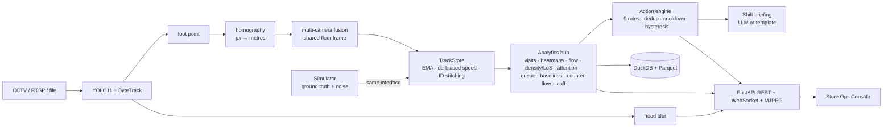

* **Edge (per store):** camera ingest → detector/tracker → floor projection → multi-camera fusion → analytics →
  real-time actions. Video never leaves the store, and the floor keeps working when the WAN is down.
* **Cloud (multi-store):** only anonymous aggregates (zone-window KPIs, bottleneck and conflict episodes, attention
  funnels, insights; a few KB per zone per 5 min), for cross-store benchmarking and layout planning.
* **Integration hooks:** `Insight` objects have a stable JSON schema (owner, horizon, action, evidence, impact,
  confidence), ready for webhooks, Slack, store PA or task systems. Dedup and cooldown stop channel spam.

More in [ARCHITECTURE.md](ARCHITECTURE.md). Every judgement call made during the build is logged in [DECISIONS.md](DECISIONS.md).

---

## 11. Privacy by design

| Principle | Implementation |
|---|---|
| No biometric data | No face detection or recognition, no appearance embeddings, no re-identification by looks (multi-camera hand-off is purely geometric). |
| No identity | Track IDs are per-session integers; raw tracker IDs are never exposed; nothing is linked across days or stores. |
| Irreversible blurring | The top 22 % of every person box is pixelated and then Gaussian-blurred on **every** frame that leaves the pipeline (MJPEG, MP4, evidence snapshots, calibration frame). |
| Data minimisation | Only anonymous floor-metre trajectories (2 Hz) and aggregates are stored, and raw video is not retained. `privacy.store_frames: none` disables even the evidence snapshots. |
| Staff privacy | The staff cue uses presence time and torso colour statistics only. |
| Edge processing | Only aggregates leave the store, in line with GDPR and India's DPDP data-minimisation and purpose-limitation principles. |

---

## 12. REST / WebSocket API reference

FastAPI app in [api/main.py](api/main.py); interactive docs at **http://127.0.0.1:8000/docs**.

| Method & path | Purpose |
|---|---|
| `GET /api/health` | device, FP16, number of runs, whether LLM briefing is enabled |
| `GET /api/stores` · `GET /api/stores/{id}` | stores, cameras (with calibration), zones, scenarios, multi-camera capability |
| `GET /api/stores/{id}/floorplan.png` | floor-plan image |
| `GET /api/stores/{id}/cameras/{cam}/frame.jpg` | first camera frame (heads blurred), for calibration |
| `PUT /api/stores/{id}/zones` | save edited zones |
| `PUT /api/stores/{id}/calibration` | compute (and optionally save) a homography; returns reprojection error + warped preview |
| `POST /api/runs` | start a run `{store_id, source: "cam1" \| "multi" \| "sim:rush_hour", speed: 1\|2\|4\|"max", duration_s?, seed?}` |
| `GET /api/runs` · `GET /api/runs/{id}` · `DELETE /api/runs/{id}` | list / status / stop |
| `GET /api/runs/{id}/stream.mjpg` · `/frame.jpg` | annotated, privacy-blurred live video / latest frame |
| `WS /api/runs/{id}/live` | every 500 ms: `{ts, people, zones, insights_delta, kpis, progress}` |
| `GET /api/runs/{id}/kpis` · `/zones` · `/flow` · `/bottlenecks` · `/attention` · `/queue` · `/layout` | analytics |
| `GET /api/runs/{id}/heatmap?type=occupancy\|stationary&window=…&format=png\|json` | heatmap PNG on the floor plan, or the raw grid |
| `GET /api/runs/{id}/insights?status=active\|all` · `POST …/insights/{iid}/ack` | action feed / acknowledge |
| `GET /api/runs/{id}/evidence/{name}` | evidence snapshot |
| `GET /api/runs/{id}/briefing` · `/report.html` · `/export.csv` | shift briefing, printable report, zone CSV |

---

## 13. Configuration reference

All tunables live in [config/default.yaml](config/default.yaml); nothing is hard-coded. Store geometry lives in
`config/stores/<store>.yaml` (cameras, calibration points, time offsets, zones, fixtures, simulator layout).

| Section | Key settings |
|---|---|
| `runtime` | `target_fps: 10`, `device: auto`, `model_gpu: yolo11s.pt`, `model_cpu: yolo11n.pt` (or `yolo11n_640.onnx`), `conf`, `iou`, `imgsz: 960`, `tracker: bytetrack.yaml` |
| `geometry` | `heatmap_cell_m: 0.25`, `heatmap_blur_sigma_cells`, `assumed_person_height_m: 1.70` |
| `tracking` | `ema_alpha`, `speed_window_s`, `position_noise_m`, `min_track_age_s`, `stitch_max_gap_s: 2`, `stitch_max_dist_m: 1.2`, `staff_filter`, `staff_long_presence_s: 1800`, `presence_lineage_*`, `staff_uniform_hsv`, `fusion_gate_m: 1.0` |
| `visits` | `enter_min_s: 1.0`, `exit_grace_s: 1.5`, `engaged_speed_mps: 0.3`, `stop_min_s: 3.0`, `exposure_buffer_m: 1.5` |
| `density` | `window_s: 5`, `bottleneck_min_duration_s: 20`, `speed_drop_ratio: 0.5`, Fruin thresholds, `aisle_speed_rule_min_los`, `bottleneck_end_windows`, `counterflow_*` |
| `attention` | `window_min: 15`, `unvisited_traffic_share: 0.2`, `ignored_stopping_power: 0.08`, `hot_quantile`, `hot_min_traffic_share`, `min_exposures` |
| `queue` | `max_wait_target_s: 180`, `window_s`, `rate_horizon_s: 300`, `rising_windows: 3` |
| `actions` | `cooldown_s: 300`, `max_active: 12`, `resolve_grace_s: 30`, anomaly thresholds, `long_stationary_s: 120`, `store_open_hours`, `promo_stopping_power_prior` |
| `briefing` | `llm_model`, `enabled_if_key`, `max_tokens` |
| `privacy` | `blur_heads: true`, `head_fraction: 0.22`, `store_frames: evidence_only \| none` |
| `sim` | `dt`, `duration_s`, `noise_sigma_m: 0.15`, `dropout_prob: 0.02`, `id_break_rate_per_s`, `id_break_gap_s` |

---

## 14. CLI & scripts reference

| Command | What it does |
|---|---|
| `python -m flowsight.cli process --store caviar_corridor --camera cam1` | full pipeline on a camera → annotated MP4, DuckDB, heatmaps, summary |
| `python -m flowsight.cli multicam --store caviar_multicam` | two-camera fused run |
| `python -m flowsight.cli sim --scenario rush_hour --duration 1500` | simulator through the full stack; prints the active actions |
| `python -m flowsight.cli eval --seeds 5 --duration 1800` | accuracy report → `runs/eval/report.md` + CSV |
| `python -m flowsight.cli mot` | CLEAR-MOT / IDF1 on CAVIAR GT → `docs/tracking_metrics.md` |
| `python -m flowsight.cli calibrate --store <id> --camera <cam>` | click points on the first frame, type floor metres → saved homography |
| `python -m flowsight.cli device` | show the compute device that will be used |
| `python scripts/autocalibrate.py --store caviar_multicam --write` | self-calibrate a second camera (clock offset + homography) |
| `python scripts/export_onnx.py` · `python scripts/bench.py [--onnx]` | ONNX export · benchmarks → `docs/benchmarks.md` |
| `python scripts/download_data.py` | test footage, ground truth, floor plans |
| `python scripts/counterflow_demo.py` | render the counter-flow illustration |
| `python scripts/export_static_demo.py` | record the demo runs into `site/demo-data/` for the static replay |
| `python scripts/deploy_pages.py [--record]` | build the static console and push it to the `gh-pages` branch (GitHub Pages) |
| `node web/scripts/readme_shots.mjs <shot…>` | regenerate the README screenshots from a running server |

`make` targets: `setup · data · process · sim · eval · test · api · web · build · demo · bench`.

---

## 15. Repository layout

```
flowsight/                    python package
  config.py                   pydantic models for all config + loaders
  io/video_source.py          file / RTSP / webcam, decimation, clock alignment
  perception/                 detector_tracker.py (YOLO11 + ByteTrack, ONNX), footpoint.py
  geometry/                   calibration.py (homography, auto-scale), zones.py, autocalib.py (cross-camera)
  tracking/                   track_store.py (EMA, de-biased speed, stitching), fusion.py (multi-camera), staff.py
  analytics/                  visits, heatmap, flow, density (LoS, bottlenecks, counter-flow), attention, queue, baseline, hub
  actions/                    engine.py (rules, what-if), briefing.py (LLM / template)
  privacy/anonymize.py        head blur
  render/annotate.py          camera + floor overlays
  storage/db.py               DuckDB schema, batched writers, Parquet export
  sim/simulator.py            agent-based shoppers with ground truth
  eval/                       evaluate.py (sim accuracy), mot.py (tracking metrics), multicam_gt.py
  pipeline.py · cli.py        orchestration (video / multi-camera / sim) · typer CLI
api/                          FastAPI app + printable report template
web/                          React + Vite + TypeScript + Tailwind + ECharts console (7 pages; `--mode static` = replay build)
config/                       default.yaml + stores/{demo_store, caviar_corridor, caviar_multicam}.yaml
scripts/                      tasks.py (make), download_data, bench, export_onnx, autocalibrate, counterflow_demo,
                              export_static_demo + deploy_pages (GitHub Pages replay demo)
tests/                        46 pytest tests
docs/                         screenshots/, benchmarks.md, tracking_metrics.md, multicam_autocalib.md, demo_script.md
runs/eval/                    accuracy report + CSV (other run outputs are gitignored)
```

---

## 16. Data sources

* **CAVIAR "Shopping Centre in Portugal"** (EC-funded CAVIAR project, University of Edinburgh): synchronised corridor
  and frontal CCTV views with per-frame ground truth (CVML XML). Used for real-video processing, multi-camera
  self-calibration and fusion, and tracking metrics. The corridor calibration is *approximate*: it is derived from a
  ground-plane model fitted to person heights.
* **MOT17-09 / MOT20-01** raw sequences (motchallenge.net): crowded scenes for detector benchmarks.
* **Simulator:** the demo supermarket's layout, attractiveness, dwell and scenarios live in
  `config/stores/demo_store.yaml → sim`.

---

## 17. Testing

```bash
make test
```

46 tests covering:
* foot points and ID stitching; homography round-trip and auto-scale;
* the Phase-3 acceptance trajectories: a 10 s stand = one visit, boundary jitter = one visit, a pass-by = exposure
  without entry, 8 people in 4 m² = an LoS ≥ D bottleneck, and Little's law W = 5 min;
* one test per action rule, plus dedup, cooldown, hysteresis and the active cap;
* the briefing in template and mocked-LLM modes;
* staff filtering (presence, colour, lineage purge) and counter-flow;
* cross-camera auto-calibration on synthetic data with a known homography and clock offset, and the fusion hand-off;
* the MOT helpers;
* every API endpoint (MJPEG, WebSocket, zone/calibration edits, camera calibration in store detail) on a short simulator run.

---

## 18. Limitations & roadmap

**Limitations (measured, not hidden)**
* Rush-hour bottleneck recall is 0.82 when 20-40 s aisle crowds sitting exactly on the threshold are counted (sustained jams: 1.00).
* The CAVIAR corridor calibration is approximate. The two CAVIAR views only overlap on a narrow strip, so most shoppers are seen by one camera at a time.
* Staff filtering without a uniform cue can be fooled by tracker identity swaps in crowds (1 of 5 simulated seeds).
* Engaged-time MAE is 2.1 s, because browsing at 0.35 m/s sits next to the 0.3 m/s threshold.
* Simulator noise is kinder than real crowds; real-video tracking is reported separately (MOTA 0.70 on CAVIAR).

**Roadmap**
1. Covariance-weighted fusion (each camera measures the along/across directions with different precision) and more than 2 cameras.
2. Batched multi-camera inference; OpenVINO / TensorRT on top of the ONNX export.
3. Webhook / Slack / task-system connectors; a POS join for true basket conversion.
4. Swap-robust staff filtering; planogram-aware what-if; cross-store benchmarking in the cloud tier.

---

## 19. Troubleshooting

| Symptom | Fix |
|---|---|
| `video for cam1 not found` when starting a camera run | run `make data` (downloads and converts the CAVIAR clips) |
| Very slow `make setup` | PyPI can be slow on some networks; the install is resumable, so rerun it. The venv lives in `~/.venvs/flowsight` when the repo is inside OneDrive/Dropbox. |
| Demo shows only the simulator | the YOLO weights are not cached under `models/` yet (needs internet once), or `make data` wasn't run |
| Briefing says `deterministic template` | expected without `ANTHROPIC_API_KEY`; set it to enable the LLM mode |
| Port 8000 busy | stop the other process, or run `python -m uvicorn api.main:app --port 8001` |
| GPU not used | `python -m flowsight.cli device` shows the device; install the CUDA PyTorch wheel (`make setup` does this when `nvidia-smi` exists) |

---

*FlowSight: from CCTV to actions. Built for the Everseen × E-Cell IIT Bombay CV AI Hackathon.*
