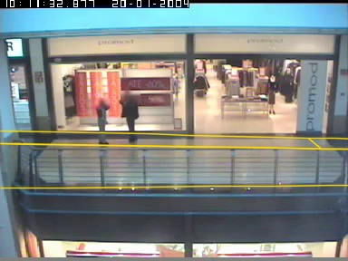
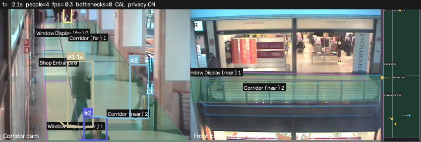

# Multi-camera auto-calibration (CAVIAR corridor + front view)

Reference camera `cam1` (calibrated) and new camera `cam2` watch the same corridor from opposite sides. Every 1nd frame of both clips was run through the production detector + tracker (truncated boxes get feet from the track's median height). Only *walking* people are used (≥ 0.4 m/s in the reference camera, ≥ 8 px/s in the new one): standing people fit any time offset and pull RANSAC onto degenerate solutions. Every walking foot point of the new camera is paired with every walking floor position of the reference camera at a candidate clock offset; a guarded LO-RANSAC (4 samples from 4 different frames, fold/area checks, per-detection capped score) finds the homography, and the offset with the most inliers wins (best of 3 restarts).

| Quantity | Value |
|---|---|
| Clock offset | **70 frames = 2.80 s** (runner-up offset 76 has 502 inliers vs 532) |
| Inlier pairs | 532 of 1506 candidates from 828 co-observed frames |
| Median residual of inliers | 0.174 m |

Inliers by offset (frames → inliers):

`-120:125, -118:140, -116:121, -114:147, -112:127, -110:155, -108:148, -106:148, -104:156, -102:164, -100:136, -98:116, -96:155, -94:132, -92:139, -90:121, -88:147, -86:127, -84:188, -82:140, -80:187, -78:141, -76:194, -74:135, -72:175, -70:211, -68:182, -66:192, -64:236, -62:148, -60:178, -58:209, -56:195, -54:232, -52:174, -50:196, -48:214, -46:169, -44:244, -42:199, -40:245, -38:226, -36:220, -34:204, -32:232, -30:207, -28:149, -26:197, -24:249, -22:192, -20:230, -18:183, -16:203, -14:249, -12:259, -10:270, -8:273, -6:224, -4:291, -2:241, 0:290, 2:295, 4:317, 6:303, 8:309, 10:309, 12:279, 14:311, 16:269, 18:318, 20:316, 22:310, 24:286, 26:289, 28:322, 30:354, 32:338, 34:354, 36:350, 38:343, 40:357, 42:351, 44:341, 46:355, 48:359, 50:351, 52:363, 54:351, 56:381, 58:363, 60:384, 62:461, 64:482, 66:512, 68:522, 69:530, 70:534, 71:528, 72:527, 74:527, 76:502, 78:486, 80:469, 82:478, 84:471, 86:485, 88:477, 90:446, 92:385, 94:362, 96:341, 98:321, 100:315, 102:274, 104:301, 106:275, 108:258, 110:271, 112:268, 114:277, 116:263, 118:270, 120:188`

## Validation against CAVIAR ground truth

CAVIAR annotates both views independently (no shared IDs). For each front-view GT person we find the corridor-view GT person whose floor trajectory is closest over their co-visible frames:

| Clip | Front GT id | ↔ corridor GT id | co-visible frames | mean distance (m) | across (m) | along (m) |
|---|---|---|---|---|---|---|
| ThreePastShop1 | 0 | 0 | 211 | 0.28 | 0.23 | 0.14 |
| ThreePastShop1 | 1 | 2 | 206 | 0.97 | 0.41 | 0.85 |
| ThreePastShop1 | 3 | 8 | 228 | 0.46 | 0.42 | 0.16 |
| ThreePastShop1 | 2 | 7 | 218 | 0.13 | 0.06 | 0.11 |
| ThreePastShop1 | 4 | 8 | 226 | 0.30 | 0.20 | 0.21 |
| ThreePastShop1 | 5 | 3 | 156 | 0.30 | 0.24 | 0.16 |
| ThreePastShop1 | 6 | 4 | 150 | 0.11 | 0.07 | 0.08 |
| OneShopOneWait1 | 0 | 1 | 172 | 0.29 | 0.17 | 0.21 |
| OneShopOneWait1 | 1 | 2 | 887 | 0.55 | 0.53 | 0.11 |
| OneShopOneWait1 | 2 | 3 | 174 | 0.17 | 0.08 | 0.14 |
| OneShopOneWait1 | 3 | 4 | 218 | 0.41 | 0.40 | 0.09 |

*The corridor zones (defined once on the shared floor plan) projected into the front camera with the recovered homography.*

## Live fusion run (`flowsight multicam --store caviar_multicam`)

Both real clips (121 s, frame-aligned with the recovered 70-frame offset) are processed together: one YOLO11s +
ByteTrack per camera → floor projection → cross-camera Hungarian association (≤ 1.0 m gate) → one global track
store → the same analytics hub as single-camera runs.

| Metric | Value |
|---|---|
| Throughput (2 cameras, detector + fusion + analytics + render, RTX 4060) | 30.0 FPS |
| Identities seen by the corridor camera / front camera | 42 / 22 |
| Fused identities (after cross-camera merging) | 52 |
| Identities observed by **both** cameras | 12 |
| Full hand-offs (first seen in one view, last seen only in the other) | 2 |
| Cross-camera observation pairs merged | 611 |
| Median floor distance between the two cameras' views of the same person | 0.31 m |

*Global IDs are shared across both views; the right panel is the fused floor plan.* The two CAVIAR views overlap only
on the strip of corridor in front of the shop (the front camera mostly sees what is below/behind the corridor
camera), so most shoppers are seen by one camera at a time — fusion's job here is consistent identity at the seam.
